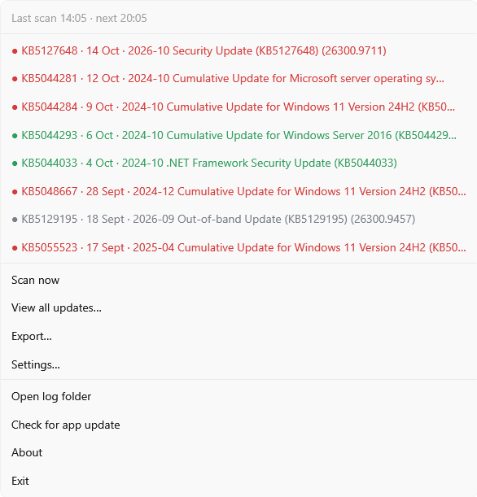
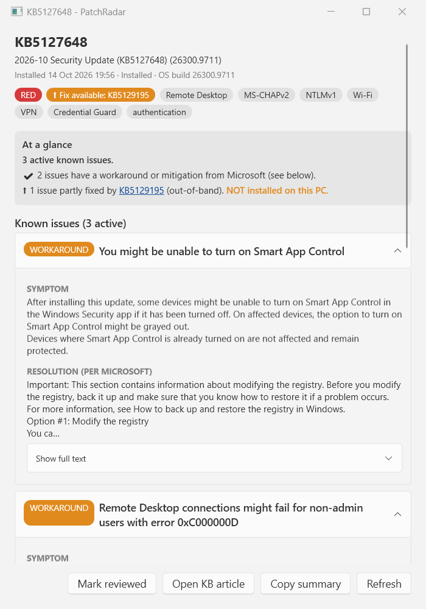
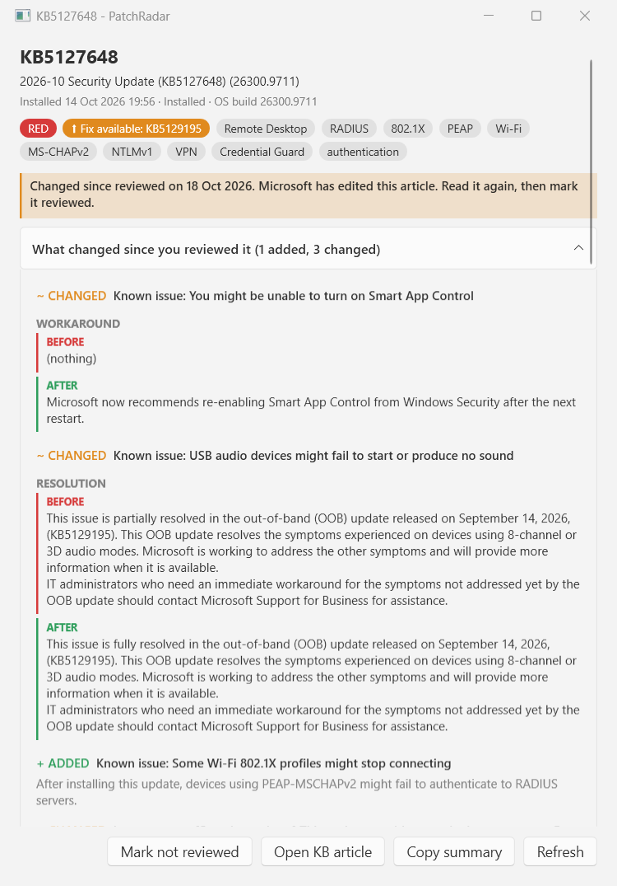
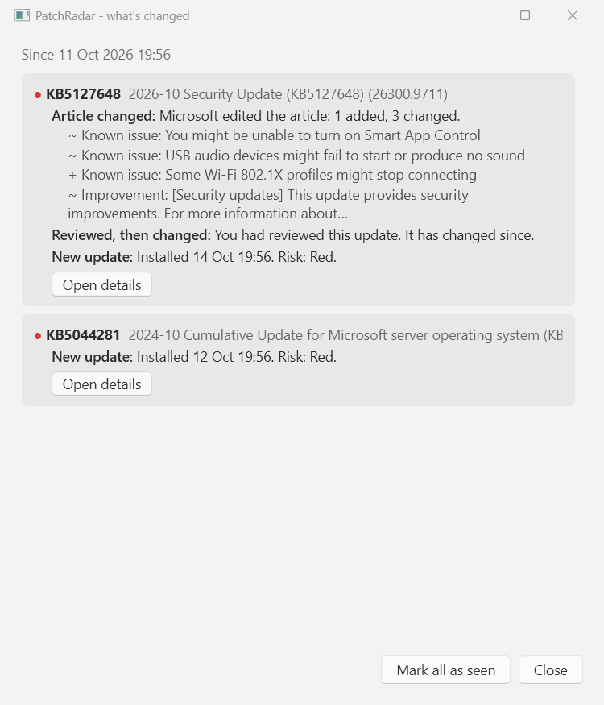
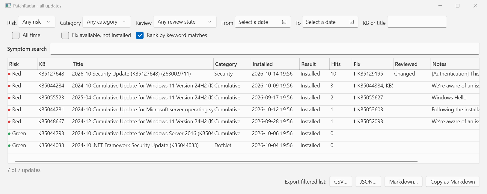
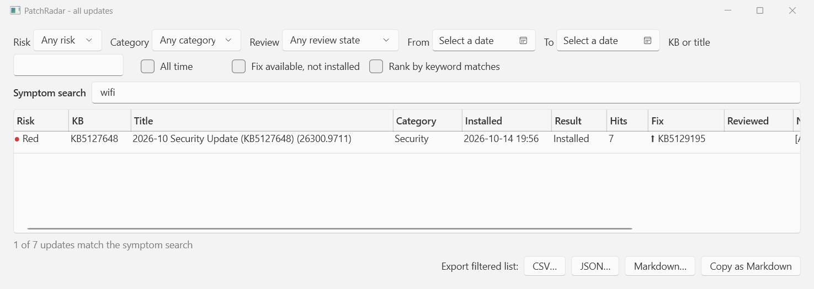
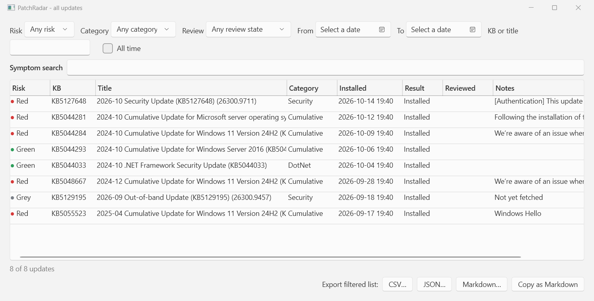
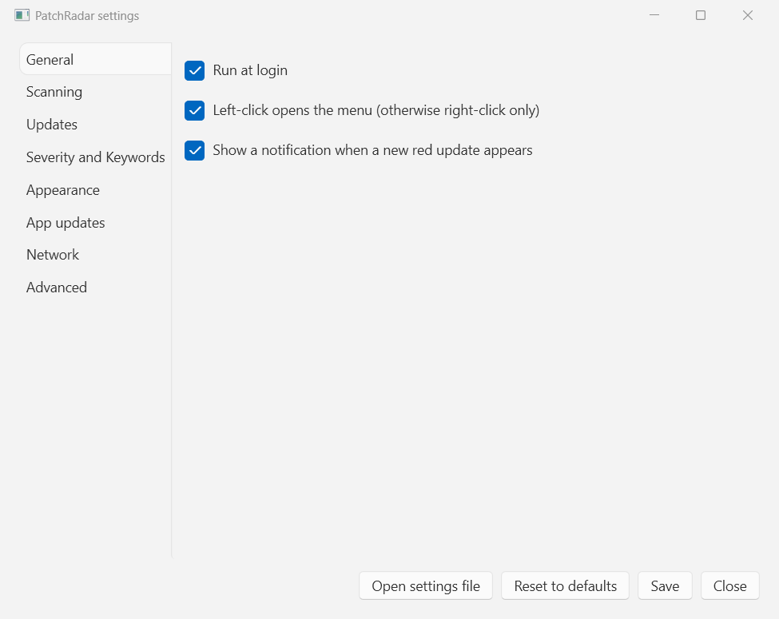
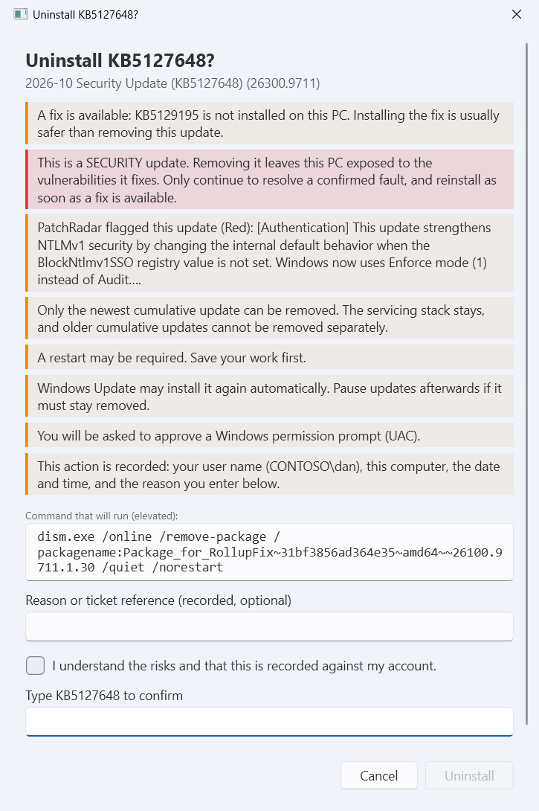

# PatchRadar
Author: Dan Rhodes ([@danrhodes](https://github.com/danrhodes))

**A tray tool that tells you which Windows update broke it.**

PatchRadar sits in the notification area, lists the updates installed on the machine, reads each update's Microsoft KB article, and colours it by risk. It pulls out what Microsoft buries: **known issues**, **workarounds**, **fixes and out-of-band updates**, and **behaviour changes hidden under "Improvements"**.

<p align="center">
<picture>
  <source media="(prefers-color-scheme: dark)" srcset="docs/images/tray-menu-dark.png">
  
</picture>
</p>

It was built for the moment an engineer sees a symptom on a machine ("Wi-Fi 802.1X stopped working", "RDP fails for standard users") and needs to know **which update did it, and what to do about it**.

## Why it exists

In October 2026 KB5127648 changed the `BlockNtlmv1SSO` default from Audit to Enforce. That silently broke MS-CHAPv2 based Wi-Fi (802.1X/RADIUS), Ethernet and VPN. Microsoft listed it under **Improvements**, not **Known issues**. A tool that only reads the Known issues section shows that update as safe.

PatchRadar flags it red, because an improvement that matches a *change phrase* ("changing the default", "enforce mode", "will no longer") **and** a *critical keyword* ("NTLMv1", "MS-CHAPv2", "Wi-Fi", "VPN") is treated as a **behaviour change**.

## Features

- **Colour-coded tray icon and menu.** Green, orange, red or grey for the newest updates. The tray icon shows the worst one.
- **Known issues with what to do next.** Every issue is a collapsible card with clearly labelled **Symptom**, **Workaround**, **Resolution** and **Fix** sections, plus an **At a glance** summary: how many issues are active, which have a fix or workaround, and which have *nothing published yet*.
- **Fix tracking.** When an article or Windows release health names the update that fixes an issue (including **out-of-band** and **partial** fixes), PatchRadar links it and tells you whether that update is **already installed on this PC**.
- **Flags fixes you have not installed.** A tray row, the detail window and the All Updates grid show **⬆ fix available** when Microsoft names a fix (including out-of-band updates) that is not on this PC. If a newer cumulative update is installed, it says that update probably already includes it.
- **Pending updates, before you install them.** Updates Windows Update has found but not yet installed are listed first in the tray menu (and in All Updates under **Pending only**), read and coloured like installed ones, so you can see the known issues and behaviour changes in advance. A toast warns when a pending update looks risky. Turn it off in Settings > Updates.
- **Pending briefing.** *Pending briefing…* in the tray menu writes a Markdown note for the updates waiting to install: risk, known issues, workarounds, behaviour changes and one line of advice (for example "Consider deferring: 2 active known issues with no fix or workaround"). Copy it into a ticket or save it. Drivers, which have no KB article, are listed too, with a comparison against the version already installed.
- **Restart needed, and restart reminders.** The tray menu shows how long the PC has been up and says when Windows is waiting for a restart to finish installing updates. After 14 days without a restart (configurable, repeating every 3 days) a notification reminds you. Off on Windows Server unless you turn it on, with its own longer threshold. See Settings > General.
- **New-pending badge.** A count on the tray icon flags pending updates you have not looked at yet. It clears when you open the menu and returns when something new turns up.
- **Why an install failed.** Failed installs show the Windows Update error code with a plain-English cause and the usual fix.
- **Ignore an update.** *Ignore* on the detail window keeps an update listed but stops it colouring the icon or raising notifications.
- **Since Windows started.** The All Updates window can filter to updates installed since Windows last started, or in the last day, week or month.
- **Headless report.** `PatchRadar.exe --report out.json` (or `.csv`, `.md`; add `--briefing` for the pending briefing) scans once with no UI. The exit code is 0 when nothing is red, 1 when a red update is pending, 2 when a red update is already installed, and 3 if the scan failed. Suits scheduled tasks and RMM tools.
- **Behaviour-change detection** in the Improvements section.
- **Before and after.** When Microsoft edits an article you had reviewed, the detail window shows exactly what changed: added, removed and edited issues, workarounds, fixes and improvements, each with a BEFORE and AFTER.
- **What's changed since I last looked.** One list of new updates, edited articles, updates that became riskier, newly named fixes and reviewed items that changed, with a badge in the tray menu.
- **Ranked by keyword matches.** Sort the grid by how many of *your* critical keywords an update matches, so the likeliest cause of a symptom rises to the top.
- **Optional uninstall for administrators** (off by default). Offered only where Windows can really remove the update, with strong warnings, a typed confirmation and an audit record. See [Uninstalling an update](#uninstalling-an-update-advanced-administrators-only).
- **Symptom search.** Type `wifi`, `NTLM` or `0x80070` and see which updates mention it.
- **Mark reviewed.** Flag an update as dealt with. If Microsoft later edits the article, PatchRadar shows **changed since reviewed**.
- **Export** the list as CSV, JSON or a Markdown table that pastes cleanly into a ticket. **Copy summary** puts one update's findings on the clipboard.
- **Notifications** for new red updates, once per update per article revision.
- **Light, dark or follow-the-system theme, adjustable text size**, and every threshold, keyword and colour is configurable.
- **Self-updating** from GitHub Releases, with checksum verification and automatic rollback. After an update the exe is renamed to the new version (`PatchRadar-v1.2.1-win-x64.exe`), and the run-at-login entry follows it.
- **Survives a blocked support site.** If `support.microsoft.com` answers 403 or 429, PatchRadar retries with different request styles, then Windows release health, then a hidden browser render. If it still cannot read an article, the detail window says so and that PatchRadar will keep trying.
- **Links that open on locked-down PCs.** When Windows will not hand a link to the default browser (a managed PC that answers "Access is denied"), PatchRadar tries other ways of opening it and, as a last resort, copies the link to the clipboard and tells you.
- **Restarts itself after a crash** (at most once every five minutes, so it can never loop).
- **Clean removal.** *Uninstall PatchRadar…* in Settings, Advanced removes the startup entry and the program file, and optionally your settings and history. See [Removing PatchRadar](#removing-patchradar).
- **No telemetry, no service, no admin rights.**

## Screenshots

### An update's detail window

Active issues open by default. Each says whether there is a fix, a workaround or nothing yet, and whether the fix is installed here.

<p align="center">
<picture>
  <source media="(prefers-color-scheme: dark)" srcset="docs/images/detail-dark.png">
  
</picture>
</p>

### A fix you have not installed, and what changed since you reviewed it

The orange **Fix available** chip and the At a glance panel name the fixing update and say it is **not installed on this PC**. After you mark an update reviewed, any later edit by Microsoft is shown as BEFORE and AFTER.

<p align="center">
<picture>
  <source media="(prefers-color-scheme: dark)" srcset="docs/images/detail-changed-dark.png">
  
</picture>
</p>

### What's changed

<p align="center">
<picture>
  <source media="(prefers-color-scheme: dark)" srcset="docs/images/digest-dark.png">
  
</picture>
</p>

### Ranking by keyword matches

<picture>
  <source media="(prefers-color-scheme: dark)" srcset="docs/images/ranked-dark.png">
  
</picture>

### Symptom search

<picture>
  <source media="(prefers-color-scheme: dark)" srcset="docs/images/symptom-search-dark.png">
  
</picture>

### All updates

Filter by risk, category, review state and date. Export respects the filter.

<picture>
  <source media="(prefers-color-scheme: dark)" srcset="docs/images/all-updates-dark.png">
  
</picture>

### Settings

<picture>
  <source media="(prefers-color-scheme: dark)" srcset="docs/images/settings-dark.png">
  
</picture>

## Requirements

- Windows 11, or Windows Server 2016, 2019, 2022, 2025 and later. Windows 10 is not supported.
- No admin rights. Reading update history works as a standard user.
- Internet access to `support.microsoft.com` and `learn.microsoft.com` (see [Privacy](#privacy)).
- Nothing else to install: the main download is self-contained.

## Install

1. Download the latest **full release** from the [Releases page](https://github.com/danrhodes/PatchRadar/releases):
   - `PatchRadar-<version>-win-x64.exe`: self-contained. Use this on Servers and anywhere you are unsure.
   - `PatchRadar-<version>-win-x64-slim.exe`: needs the .NET 10 Desktop Runtime. Smaller.
2. Put it in a per-user folder, for example `%LOCALAPPDATA%\Programs\PatchRadar\PatchRadar.exe`.
3. Run it. An icon appears in the notification area (it may be in the overflow arrow). By default PatchRadar starts at login; turn that off in **Settings, General**.

Why per-user: the folder is writable without elevation, so the built-in updater can replace the exe in place. In `Program Files` the updater cannot write, so it falls back to telling you a new version exists.

Keep the exe in a folder that stays put (not Downloads, which cleanup tools empty). If the file is moved or deleted by hand, the start-at-login entry is left pointing at nothing. To remove PatchRadar, use [Removing PatchRadar](#removing-patchradar) instead of deleting the file.

When PatchRadar updates itself it renames the file to match the new version, so `PatchRadar-v1.1.0-win-x64.exe` becomes `PatchRadar-v1.2.1-win-x64.exe` and the start-at-login entry is updated to match. A file name with no version in it (for example `PatchRadar.exe`) is kept as it is.

**Verify your download** (see [Code signing policy](#code-signing-policy) and [Provenance](#provenance-and-integrity)):

```powershell
Get-FileHash .\PatchRadar-v1.0.0-win-x64.exe -Algorithm SHA256   # compare with the .sha256 asset
Get-AuthenticodeSignature .\PatchRadar-v1.0.0-win-x64.exe        # signed releases only
```

If your antivirus or EDR (Defender, ThreatLocker and similar) objects to an exe that renames and replaces itself, allow `PatchRadar.exe` in its install folder. See [App updates](#app-updates).

## Using PatchRadar

### The tray

Left- or right-click the icon (left-click is configurable). Top to bottom:

| Item | What it does |
|---|---|
| Header | Time of the last scan and the next one. Shows `Scanning… (3/15)` while working. |
| Uptime, restart | **Up 17 days** (orange with "consider restarting" past the reminder threshold), and a line when Windows is waiting for a restart. |
| Pending | Updates Windows has found but not installed, above the installed list. Drivers with no KB article are listed too. |
| Update rows | The newest updates (15 by default), newest first. Dot and text are coloured by risk. A tick and dimmed text mean you marked it reviewed; **⬆ fix available** means a fix exists that is not installed here; **changed since reviewed** means Microsoft edited an article you had reviewed. Hover for the first matched issue. Click to open the detail window. |
| Scan now | Rescans and refreshes updates inside the recent window. |
| View all updates… | The full list with filters and symptom search. |
| Pending briefing (N)… | A copyable Markdown note on everything waiting to install, with advice on each. |
| What's changed (N)… | Everything that changed since you last looked. The number counts updates with news. |
| Export… | CSV, JSON, Markdown, or copy as Markdown. |
| Settings… | Every setting. Changes apply immediately. |
| Uninstall history… | Only shown to administrators who turned on uninstalling. Who removed what, and when. |
| Open log folder | Opens `%LOCALAPPDATA%\PatchRadar\logs`. |
| Check for app update | Becomes **Restart to update to vX.Y.Z** when an update is staged. |
| About, Exit | |

The icon takes the worst colour of the updates in the menu. While a scan runs it is grey.

### What the colours mean

| Colour | Meaning |
|---|---|
| 🟢 **Green** | The article was read. No active known issues and no behaviour change involving a critical keyword. |
| 🟠 **Orange** | At least one active known issue, but nothing matching a critical keyword. |
| 🔴 **Red** | An active known issue, or a behaviour change, that matches a critical keyword (authentication, VPN, BitLocker, RDP, boot, print and so on). |
| ⚪ **Grey** | No data: not fetched yet, the fetch failed, or Microsoft has no article for it. Common for Defender definition, MSRT and some driver updates. |

**Resolved issues never count.** "Partially resolved" is still active.

### The detail window

Click any update. From the top:

1. **Header**: KB, title, install date and result, OS build, the risk pill and the keywords that matched.
2. **At a glance**: the active-issue count, which issues have a fix (and whether it is installed here), which have a workaround, and which have **no fix or workaround yet**.
3. **Known issues**: one card per issue.
   - A tag says where it stands: `ACTIVE` (no fix or workaround), `WORKAROUND`, `FIX AVAILABLE`, `PARTIAL FIX`, `RESOLVED`.
   - Inside: **Symptom**, then **Fix** (a link to the fixing update, with `out-of-band` and `installed on this PC` / `not installed` markers), **Workaround**, **Resolution (per Microsoft)** and **Next steps**.
   - Long guidance (registry steps, policy walkthroughs) shows a short preview with **Show full text**, so the window stays scannable.
   - Resolved issues are collapsed and greyed.
4. **Behaviour changes**: improvements flagged as risky, highlighted.
5. **Improvements**: the full list, collapsed.

If Microsoft's support site is refusing requests, the window says so in place of the article, shows when PatchRadar will next try, and suggests **Refresh** or opening the article in your browser. Nothing is wrong with the update itself.

Buttons: **Mark reviewed**, **Ignore**, **Open KB article** (your browser; if Windows will not open it, the link is copied to the clipboard), **Copy summary** (plain text for ticket notes), **Refresh**.

> "Resolution (per Microsoft)" is the heading Microsoft uses. In practice it is sometimes guidance (a registry change, a policy) rather than a fix. A **Fix** line only appears when an update is actually named.

### Finding the update behind a symptom

Open **View all updates…** and use **Symptom search**. It searches the cached improvements, known issues and workarounds of every update. It ignores case and punctuation, so `wifi` finds "Wi-Fi" and `mschapv2` finds "MS-CHAPv2". Hex codes like `0x80070` work as typed. Combine it with the risk, category, review and date filters. Tick **Rank by keyword matches** to order the list by how many of your critical keywords each update matched (the **Hits** column), then by risk, then by date. With the symptom box and the ranking together, the update most likely to explain a symptom is first.

### Reviewing and "changed since reviewed"

**Mark reviewed** keeps a snapshot of the article as you read it. If Microsoft edits it (a new workaround, a new known issue, a fix named, wording changed), the update shows **Changed since reviewed** in the menu, the grid and the detail window, and the detail window lists every change with **BEFORE** and **AFTER**, until you review it again. The comparison is of the *text*, so a PatchRadar upgrade that re-reads articles differently never raises a false alarm. Reviewing never changes the risk colour; it is a note to yourself.

### What's changed since I last looked

**What's changed…** in the tray menu lists, since the last time you pressed **Mark all as seen** (a week back the first time):

- updates installed since then;
- articles Microsoft edited, with the first few changes spelled out;
- updates that **became riskier** (for example Green to Red);
- a fix that is **now named** for an issue that had none;
- updates you had reviewed that have changed.

Each has **Open details**. The menu shows how many updates have news.

### Fixes you have not installed

For every issue where an article or Windows release health names a fixing update, PatchRadar checks whether that update is installed. It shows **⬆ fix available** on the tray row, an orange **Fix available** chip and a line in **At a glance** saying *NOT installed on this PC*. This includes issues Microsoft calls resolved: "resolved in KB…" only helps a machine that has that KB. If a newer cumulative update than the affected one is installed, PatchRadar adds that it probably already includes the fix. In the grid, tick **Fix available, not installed** to list only those updates.

### Exporting

From the tray (all scanned updates) or the All Updates window (the **filtered** list): CSV (opens cleanly in Excel), JSON (full detail), or a Markdown table with KB links. **Copy as Markdown** is the fastest route into a ticket.

## Uninstalling an update (advanced, administrators only)

PatchRadar can remove an update from the machine. It is **off by default** and meant for administrators who have confirmed an update is the cause of a fault.

**Turn it on:** Settings, Advanced, **Allow uninstalling updates**.

**Who sees it.** Only administrators. A standard user never sees the button, the history item or any mention of it, even with the setting on. (Administrators running with the normal limited UAC token count; PatchRadar does not need to be started elevated.)

**Where it appears.** An **Uninstall…** button in an update's detail window, **only where removal is actually possible**. PatchRadar reads the same servicing records Windows uses, so the button is not a guess:

| Update type | Method | Offered? |
|---|---|---|
| The **newest** cumulative or security update | `dism /online /remove-package` | Yes. wusa cannot remove these. Only the cumulative part goes; the servicing stack stays. |
| An **older** cumulative update | | No. Windows has superseded it; only the newest can be removed. |
| **Servicing stack** updates | | **Never.** They cannot be removed. |
| Standalone updates Windows lists under Installed updates (for example some .NET Framework updates) | `wusa /uninstall /kb:` | Yes |
| Defender definitions and platform, Malicious Software Removal Tool | | No. Windows replaces them. |
| Drivers, Office, modern .NET runtime updates | | No. They are removed elsewhere (Device Manager, Office, Installed apps). |
| Anything Windows does not list as a removable package | | No |

**The warnings.** Clicking **Uninstall…** opens a confirmation that cannot be clicked through by accident. It tells you, as applicable:

- a fix is available and installing it is usually safer;
- it is a **security update**, and removing it leaves the PC exposed to what it fixes;
- whether PatchRadar flagged a problem with it (and if it did not, to be sure it is the cause);
- only the newest cumulative update can be removed;
- a restart may be required;
- Windows Update may install it again, so pause updates if it must stay removed;
- you will get a Windows permission (UAC) prompt;
- the exact command that will run;
- that the action is recorded against your account.

<p align="center">
<picture>
  <source media="(prefers-color-scheme: dark)" srcset="docs/images/uninstall-confirm-dark.png">
  
</picture>
</p>

You can add a **reason or ticket reference**. The **Uninstall** button stays disabled until you tick the acknowledgement **and type the KB number**. Cancel is the default.

**The audit record.** Every attempt is written to `%LOCALAPPDATA%\PatchRadar\audit\uninstall-audit.jsonl`, one JSON line per event. A removal gets a **Started** line before anything runs and an outcome line afterwards (Succeeded, Succeeded with restart required, Cancelled when the UAC prompt was declined, or Failed with the code). Each line holds the date and time (UTC and local), the **user name** (`DOMAIN\user`), the computer, the KB, the title, the method and exact command, the exit code and your reason. If the record cannot be written, **nothing is run**. **Uninstall history…** in the tray menu shows the log. It is a local record for accountability, not tamper-proof: its owner can edit the file. Forward it to your RMM or SIEM if you need an immutable trail.

**After a removal** PatchRadar rescans. A restart may be needed before Windows stops listing the update. PatchRadar never hides the update from Windows Update for you.

## How the risk is decided

1. The KB article is fetched from `support.microsoft.com` and parsed **by heading text**, never by CSS class, so Microsoft page redesigns rarely break it.
2. **Known issues** are read from tables, expandable sections or plain paragraphs. If the structure is unrecognised, the raw text is kept; data is never dropped.
3. **Improvements** that contain a *change phrase* and a *critical keyword* become **behaviour changes**.
4. Active issues and behaviour changes are matched against the **critical keywords** (word-boundary, case-insensitive).
5. Fix information comes from the article text ("addressed in KB…", "resolved in the out-of-band update KB…") and from the Windows **release health** page for your OS, matched by the update that introduced the issue.

If the support site blocks a request (HTTP 403 or 429), PatchRadar works down a list:

1. The plain request is retried in a different style: the `en-us` page with Edge's identity and full browser-style headers, then the `en-gb` page as Firefox. If the site sends a `Retry-After`, it is honoured (up to 30 seconds).
2. A hidden browser render of the real article (WebView2, on by default; skipped cleanly where the runtime is missing).
3. Windows release health, which supplies known issues only.

If all of that fails the update stays grey, the detail window explains that the site is not answering, and PatchRadar keeps retrying on its own (after 1 hour, then 6, then daily). Fetches are rate-limited (two at a time, 500 ms apart) and cached. A scan reads articles side by side within that limit, and starts the Windows Update search for pending updates at the same time, so one slow retry does not hold up the rest.

## Settings reference

Settings live in `%APPDATA%\PatchRadar\settings.json`. Use the Settings window, or edit the file; **Open settings file** is in the window. Unknown keys are kept, invalid values fall back to defaults with a log warning, and a corrupt file is backed up as `settings.json.bad`.

| Section | Key | Default | Meaning |
|---|---|---|---|
| general | `runAtLogin` | `true` | Start at login (HKCU Run). |
| | `leftClickOpensMenu` | `true` | Otherwise right-click only. |
| | `toastOnNewRed` | `true` | Notify once per red update per article revision. |
| | `showIconBadge` | `true` | Count of unseen pending updates on the tray icon; clears when you open the menu. |
| rebootReminder | `enabled` | `true` | Remind you to restart after a long uptime. |
| | `afterDays` | `14` | Days without a restart before the first reminder (1 to 365). |
| | `repeatDays` | `3` | Remind again every this many days. `0` reminds once per start-up. |
| | `remindOnServers` | `false` | Windows Server is off by default; servers restart in planned windows. |
| | `serverAfterDays` | `45` | Threshold used on Windows Server when `remindOnServers` is on. |
| scanning | `scanOnStartup` | `true` | |
| | `startupDelayMinutes` | `30` | `0` scans immediately. |
| | `scanIntervalMinutes` | `360` | `0` disables periodic scans. |
| | `cacheHoursRecent` | `12` | Refresh interval for updates inside the recent window. |
| | `cacheDaysOlder` | `7` | Refresh interval for older updates. |
| | `recentWindowDays` | `30` | What counts as recent. |
| updates | `menuItemCount` | `15` | Rows in the tray menu (5 to 100). |
| | `historyDays` | `90` | History window. `0` is all time. |
| | `includeCategories` | all except Definition | Security, Cumulative, DotNet, ServicingStack, Driver, Office, Other. |
| | `excludeTitleRegex` | Defender definition patterns | Titles matching are hidden. |
| | `showFailed` | `false` | Show failed installs. |
| | `showPending` | `true` | List updates Windows has found but not installed yet. |
| severity | `criticalKeywords` | `[]` (built-ins) | See below. |
| | `changePhrases` | `[]` (built-ins) | See below. |
| | `treatBehaviourChangesAsIssues` | `true` | Turn off for "known issues only" behaviour. |
| | `dimReviewed` | `true` | Dim reviewed rows in the menu. |
| appearance | `theme` | `System` | `System`, `Light`, `Dark`. Follows the OS live. |
| | `fontSize` | `0` | Text size for the menu and windows (8 to 24). `0` is the Windows default; windows apply it when opened. |
| | `colors` | green `#2E9E5B`, orange `#E08A1E`, red `#D63A3A`, grey `#7A7F87` | |
| appUpdate | `mode` | `Auto` | `Off`, `Notify`, `Auto`. |
| | `channel` | `Stable` | `Stable` or `PreRelease`. |
| | `checkIntervalHours` | `24` | |
| | `applyAutomatically` | `true` | `false` stages the update and waits for **Restart to update**. |
| | `skippedVersion` | `""` | A version you chose to skip. |
| network | `proxy` | `""` | Blank uses the system proxy. Credentials are not stored. |
| | `timeoutSeconds` | `30` | |
| | `userAgent` | `""` | Blank uses a current browser User-Agent. |
| | `maxConcurrent` | `2` | Applies after a restart. |
| advanced | `logLevel` | `Information` | |
| | `enableReleaseHealthFallback` | `true` | Release health as fallback and enrichment. |
| | `enableUninstall` | `false` | Offer **Uninstall…** to administrators on removable updates. See [Uninstalling an update](#uninstalling-an-update-advanced-administrators-only). |
| | `enableWebView2Fallback` | `true` | Hidden browser render when the site blocks plain requests. Needs the WebView2 runtime, which is often absent on Servers (skipped cleanly). Installs that saved this as `false` keep it off. |

### Tuning the keywords

An empty list means "use the built-in defaults". The Settings window shows the **effective** list; edit it one entry per line. A line starting with `re:` is a regular expression. If you leave a list identical to the defaults it is stored empty, so future default improvements still reach you.

Built-in critical keywords cover authentication and network (RADIUS, 802.1X, EAP, PEAP, MS-CHAPv2, NTLM, Kerberos, NPS, Wi-Fi, WPA, VPN, L2TP, IKEv2, SSTP, Always On VPN), access (Remote Desktop, RDP, Windows Hello, sign-in, logon), security (BitLocker, recovery key, Secure Boot, TPM, Credential Guard, LSASS, Netlogon, certificate), infrastructure (Active Directory, domain controller, DNS, DHCP, SMB, Hyper-V, cluster, print, spooler) and failure modes (boot, BSOD, blue screen, stop error, black screen, crash, data loss, fails to start).

Typical tuning:

- **Too noisy?** Remove a broad word such as `crash` or `print`, or add a regex that is more specific, for example `re:print(er)? (spooler|driver)`.
- **Missing something you care about?** Add it, for example your VPN product name or `re:Citrix`.
- **Change phrases** decide what counts as a behaviour change. Add wording you see Microsoft use, for example `now defaults to`.

After changing keywords, press **Scan now**; severity is recomputed from the cache without refetching.

## App updates

By default PatchRadar checks GitHub Releases once a day and updates itself on the **Stable** channel. It downloads the exe, checks its SHA-256 against the `.sha256` asset in the same release, swaps it in place under the new version's file name, and restarts. The previous exe is kept as `.old` until the new build has stayed up for 60 seconds. If the new build does not stay up on two starts, PatchRadar rolls back to the previous exe (with its old name) and skips that version. A development build never updates itself.

- **Off**: no automatic checks (the tray's manual check still works, as Notify).
- **Notify**: shows a notification and a menu item that opens the release page.
- **Auto**: downloads, verifies, applies. With `applyAutomatically` off it stages the update and shows **Restart to update**.
- **PreRelease** channel: also offers builds of every push to `main`. These are unsigned and verified by hash only.

### Provenance and integrity

- The `.sha256` file sits in the same release as the exe. It catches corrupt or interrupted downloads. It does **not** stop someone who has compromised the repository or a release token, because they could replace both files.
- Signed releases add an Authenticode signature. Once the updater enforces it, only builds signed through SignPath Foundation are installed on the Stable channel, which does cover a compromised repository.
- Every release asset carries a GitHub build attestation. Verify one by hand:

  ```powershell
  gh attestation verify .\PatchRadar-v1.0.0-win-x64.exe --repo danrhodes/PatchRadar
  ```

- Downloads are limited to `https` on GitHub hosts, and every redirect hop is re-checked.
- SmartScreen reputation for a newly signed app builds over time; early downloads can still show a warning.

## Code signing policy
Code signing provided by Certum - https://shop.certum.eu/

## Privacy

PatchRadar has no telemetry and sends no data about you or your machine to the author. It contacts only these hosts:

- `support.microsoft.com` and `learn.microsoft.com`, to read the public KB article and release-health pages for updates installed on your machine. The request contains the KB number; the HTTP request itself reveals your IP address to Microsoft, as any web request does.
- `api.github.com`, `github.com`, `objects.githubusercontent.com` and `release-assets.githubusercontent.com`, to check for and download app updates. Turn this off with App updates mode `Off`.

Fetched pages are treated as untrusted: they are parsed to text and never rendered or executed. (The optional WebView2 fallback renders the page in a hidden browser to read its text; navigation is limited to `microsoft.com` and downloads and pop-ups are refused.)

Everything stays on your machine:

| What | Where |
|---|---|
| Settings | `%APPDATA%\PatchRadar\settings.json` |
| Reviewed and notified state | `%APPDATA%\PatchRadar\state.json` |
| KB cache | `%LOCALAPPDATA%\PatchRadar\cache\` |
| Logs (daily, 14 kept) | `%LOCALAPPDATA%\PatchRadar\logs\` |
| Downloaded updates | `%LOCALAPPDATA%\PatchRadar\updates\` |

### Removing PatchRadar

Use **Settings, Advanced, Uninstall PatchRadar…**. It asks for confirmation, then asks separately whether to also delete your settings, review history and logs (choose No to keep them in case you reinstall). Then it:

1. removes the `PatchRadar` value from `HKCU\Software\Microsoft\Windows\CurrentVersion\Run`;
2. exits PatchRadar;
3. deletes the exe and its `.old` and `.failed` leftovers, and the two data folders above if you chose to, using a small script that waits for PatchRadar to finish exiting.

Please use this instead of deleting the exe by hand. Deleting it yourself leaves the start-at-login entry behind, and PatchRadar cannot clean that up because it is no longer there. To do it manually: exit PatchRadar, delete the exe, and remove the `Run` value above. It also removes the two folders in the table if you want to clear your data.

PatchRadar **reads** update history. It installs nothing and never hides updates. The only change it can make to the machine is the optional, administrator-only, audited [uninstall](#uninstalling-an-update-advanced-administrators-only), which is off unless you turn it on.

## FAQ and troubleshooting

**An update is grey.** There is no usable data. Hover or open it: the window shows why (Microsoft has no article, the request was blocked, or it has not been fetched yet). Defender definition, Malicious Software Removal Tool and many driver updates have no KB article. Press **Refresh** in the detail window to retry now; otherwise it retries on a back-off (1 hour, 6 hours, then daily; 404s weekly).

**It says "bot challenge" or HTTP 403.** The support site sometimes blocks automated requests. PatchRadar already tries other request styles, a hidden browser render (needs the WebView2 runtime) and release health (known issues only), and keeps retrying on its own; see [How the risk is decided](#how-the-risk-is-decided). Press **Refresh** to try now, or open the article in your browser. Keep the request volume low: do not shorten the cache intervals.

**"Open KB article" does nothing.** On some managed PCs Windows refuses to hand links to the default browser ("Access is denied" in the log). PatchRadar tries several other launchers; if none works it copies the link to the clipboard and says so. Paste it into a browser. If this happens on a machine you manage, check the default-apps and browser policies.

**PatchRadar closed on its own.** It restarts itself after a crash, at most once every five minutes. Details of the crash are in the log (**Open log folder**); please attach the day's log to an issue.

**Everything is red.** The critical keyword list is deliberately broad. Remove words that do not matter in your environment (see [Tuning the keywords](#tuning-the-keywords)), or review items you have dealt with.

**An update is red but I cannot see a fix.** The At a glance panel says whether a fix or workaround is published. If it says none, there is nothing to apply yet; **Refresh** later, because Microsoft edits these articles.

**The fix is "not installed on this PC".** Install the named update (often an out-of-band update) from Windows Update or the Microsoft Update Catalog, then **Scan now**.

**How do I remove PatchRadar?** Settings, Advanced, **Uninstall PatchRadar…** (see [Removing PatchRadar](#removing-patchradar)). Do not just delete the exe: the start-at-login entry would be left behind.

**The icon is missing.** Windows hides new tray icons behind the overflow arrow. Drag it out, or check Settings, Personalisation, Taskbar.

**It will not start twice.** By design: one instance per machine (a named mutex).

**Where is the log?** Tray menu, **Open log folder**. Raise detail with `advanced.logLevel` set to `Debug`.

**Can it uninstall a bad update?** Yes, for administrators who enable it, and only where Windows can really remove the update (usually the newest cumulative update). See [Uninstalling an update](#uninstalling-an-update-advanced-administrators-only). Servicing stack updates and anything else Windows cannot remove never get the button.

**Why is there no Uninstall button?** Uninstalling is off by default, hidden from standard users, and only offered where removal is possible. Check Settings, Advanced, that you are an administrator, and that the update is the newest cumulative update or a standalone package. The reason an update is not removable is in `--diag` output ("Uninstall planner").

**Does it work offline?** The list and any cached KB data do. Fetching articles needs the internet.

**Does it support Windows 10?** No.

## Building from source

Requires the .NET 10 SDK on Windows.

```powershell
git clone https://github.com/danrhodes/PatchRadar.git
cd PatchRadar
dotnet build src/PatchRadar -c Release
dotnet test tests/PatchRadar.Tests -c Release       # offline; no test touches the network
```

Self-contained single file, as the release workflow builds it:

```powershell
dotnet publish src/PatchRadar -c Release -r win-x64 --self-contained true `
  -p:PublishSingleFile=true -p:IncludeNativeLibrariesForSelfExtract=true `
  -p:EnableCompressionInSingleFile=true -o publish
```

Useful command-line modes:

| Command | Purpose |
|---|---|
| `PatchRadar.exe --diag out.txt [KB5127648 …] [--webview]` | Headless: times update collection, fetches the KBs live, reports release health and (optionally) WebView2. |
| `PatchRadar.exe --verify out.txt <file>` | Authenticode verdict for a file. |
| `tools/test-matrix.ps1 -Exe PatchRadar.exe` | Self-check for a machine in the OS matrix. |
| `tools/make-icons.ps1` | Regenerates the icons in `assets/`. |

The architecture and every decision are in [guide.md](guide.md); progress and the decision log are in [tracker.md](tracker.md). Releases are built by GitHub Actions: every push to `main` makes an unsigned pre-release, and a manual run makes a signed full release.

## Contributing

Issues and pull requests are welcome. Please:

- Build parsers against **saved fixtures** (`tests/PatchRadar.Tests/Fixtures`), not guesses, and locate content by heading text rather than CSS class.
- Keep tests offline.
- Include a fixture when you report a KB page that parses wrongly (save the article's HTML).

## Licence

MIT. See [LICENSE](LICENSE).
